# kitchen_manager_app_IA

> A desktop app that shows my family's kitchen as a clickable 3D model, so you can see where things are kept, keep track of stock and expiry dates, and get reminders. It runs in English or Vietnamese.

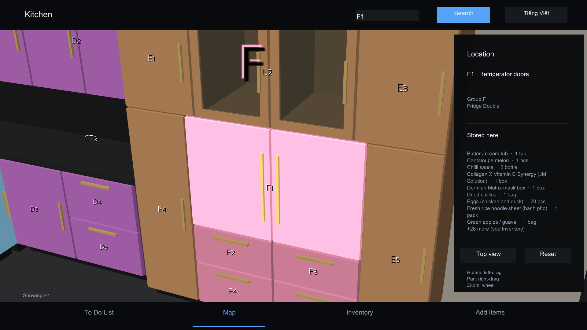

**Part of [phamduylong.com](https://phamduylong.com)** · `type: school` · `status: finished` · `Internal Assessment, IB Computer Science, May 2027 session`

---

## Why I built it

After we moved, my mother had to work in a new kitchen that she hadn't organised herself. It has 32 compartments, 266 kinds of item and 610 objects. She often forgot where things were and opened several cabinets before finding what she wanted. She also missed expiry dates and only found out mid-cooking, which meant throwing food away and making extra trips to the market.

A paper list would still have to be searched by hand. So I built an app that does both jobs: it shows where an item is, and it keeps track of expiry dates and stock. My mother was the client for my IB Computer Science Internal Assessment.

## Before → after

| Before | After |
| --- | --- |
| Open cabinet after cabinet to find something, and find out an item has expired halfway through cooking | Search "salmon" and the freezer drawer lights up on a 3D map. The To Do page lists what has expired, what is running low and what needs buying soon |

## What it does

The app has four pages, which you switch between from the bar at the bottom.

- **Map:** the whole kitchen as one 3D model with 32 clickable compartments across three areas: the sink wall, the top wall and the island.
  - Click a compartment to highlight every door of it and list what's inside on the right.
  - If a compartment holds more than nine items, the list ends with "+N more (see Inventory)".
- **Inventory:** every item, eight to a page.
  - Pick one to see its details.
  - From there you can use **Use 1** and **Add 1**, **Show on map**, **Edit** or **Delete**.
- **To Do List:** alerts built from the data:
  - items that are past their expiry date
  - items that are out of stock
  - items at or below their own low-stock level
  - restock dates that fall within the next five days
- **Add Items:** a form for every field (name, type, category, quantity, unit, location code, expiry date, low-stock level, restock date and notes). The same form is used to edit an item.
  - Missing fields, quantities that aren't numbers or are negative, wrong date formats and unknown location codes are each rejected with their own error message.

The rest is shared by every page:

- **Search** works differently on each page.
  - On the Map page it jumps to a location code (`a4`) or to the compartment holding the first matching item.
  - On the Inventory page it filters the list by name, type, category or location.
- **The Tiếng Việt / English button** switches the whole interface, item names included, while the database stays in English.

## How to use the map

| Input | Action |
| --- | --- |
| Left-click | Select a compartment (click empty space to deselect) |
| Left-drag | Rotate |
| Right-drag | Pan |
| Mouse wheel | Zoom |
| `T` or **Top view** | View from above |
| `R` or **Reset** | Back to the starting view |
| `Esc` | Quit |

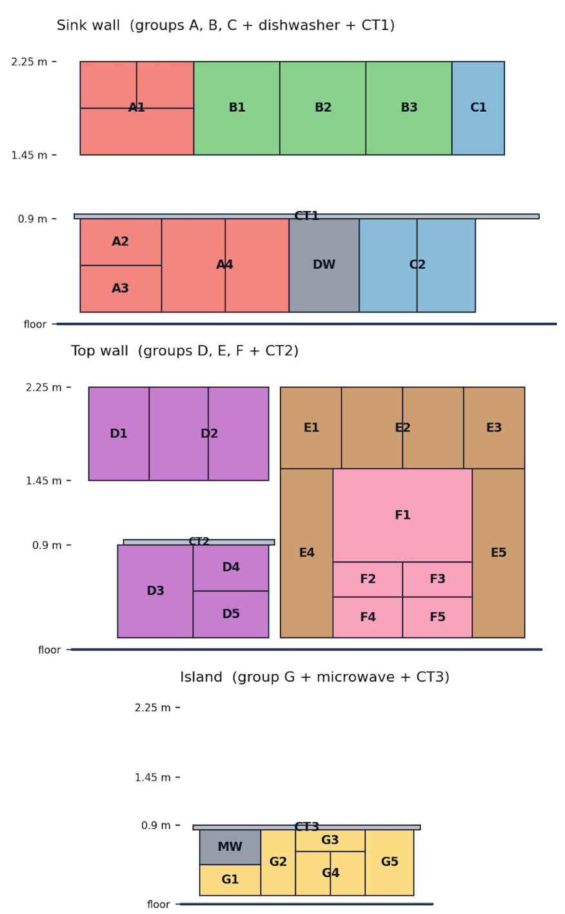

## How it works

The app has five modules, and they only depend on each other in one direction.

| Module | Job |
| --- | --- |
| `app.py` | The controller (`KitchenManagerApp`). It is the only module that changes the stored data, and it holds the validation and the alert rules. |
| `store.py` | `SQLiteItemStore`: the SQLite database and its CSV copy |
| `map_view.py` | The 3D kitchen model, the camera and click picking |
| `ui.py` | The four pages, built with Panda3D's DirectGUI. They send user actions back to the controller. |
| `i18n.py` + `translations_items.py` | English/Vietnamese text, and Vietnamese names for the items |

- **Clicking a compartment in 3D.**
  - Every visible door, drawer and shelf has an invisible collision box tagged with its location code.
  - A click sends a ray from the camera through the mouse, sorts the hits by depth and takes the nearest code.
  - The left button also rotates the map, so any movement under 0.02 screen units counts as a click and anything more counts as a drag.
- **36 parts, 32 locations.** Some compartments are drawn the way they really look, with two doors and an open shelf leading into one space. Two dictionaries built at startup map a code to all of its parts, so selecting a code highlights every part of it at once.
- **SQLite with a CSV copy.**
  - Items live in `kitchen.db`. Typed columns and `CHECK` constraints back up the validation, searches are case-insensitive, and every query is parameterised, so text typed into search is never run as SQL.
  - After every change the app also writes `items.csv`, a copy that can be read in any editor.
  - On the very first run, if `items.csv` already exists, it is used to fill the empty database. Any broken row is reported and skipped.
- **One row per kind of item.** A row stores how many there are (`quantity` plus `unit`), so 266 rows cover 610 objects. That's what makes **Use 1** / **Add 1** and the low-stock alerts work. A low-stock level of 0 turns the alert off, which suits durable items that never get used up.
- **Translation without breaking anything.**
  - Internal keys stay in English, and only text shown on screen goes through `i18n.t()`.
  - Panda3D's default font is missing some Vietnamese letters. At startup the app looks for a font that has them: a `font.ttf` next to `app.py`, then common macOS system fonts. If none is found, the app stays in English and explains why.

## Built with

`Python` · `Panda3D` · `SQLite` (`sqlite3`) · `csv` · `datetime`

## Run it

```bash
git clone https://github.com/pdlong-09/kitchen_manager_app_IA.git
cd kitchen_manager_app_IA
pip install -r requirements.txt
python app.py
```

- **The app starts with an empty kitchen.** My family's item list isn't in this repo, so add items from the **Add Items** page.
- **Loading a list instead.** Before the first run, put an `items.csv` next to `app.py` with these headers:
  `item_id, name, item_type, category, quantity, unit, location_code, expiry_date, low_stock_level, restock_date, notes`
  Dates use `YYYY-MM-DD`.
- **Vietnamese on Windows or Linux:** copy a font that has Vietnamese characters into the folder as `font.ttf`, such as Arial or any Noto Sans.

## Files

| File | What it is |
| --- | --- |
| `app.py` | Entry point and controller: page switching, search, validation, alerts |
| `store.py` | SQLite store, CSV import and the CSV copy |
| `map_view.py` | 3D kitchen model, camera controls, click picking |
| `ui.py` | Map, Inventory, To Do List and Add Items pages |
| `i18n.py` | Interface text in both languages, language toggle, font check |
| `translations_items.py` | Vietnamese names and notes for the items |
| `docs/` | Screenshots for this README |

## What I learned

I tested twice: once during development, when the database was almost empty, and again after I had entered the whole kitchen. Three problems only appeared with the real data:

- **176 alerts at once.** Every item with a quantity of one also had a low-stock level of one, so durable items that never get used up set off alerts. I made a level of 0 mean "never alert", and the To Do page dropped to the one real alert: sugar running low.
- **A hidden list.** Compartment F1 holds 35 kinds of item, but the side panel showed nine with no sign there were more. I added the "+26 more" indicator.
- **The wrong compartment for "salmon".** An unrelated item whose category contained "fish" came first, so the wrong compartment lit up.

Collecting the data after building both halves of the app, but before final testing, was the right order. If I'd only tested with the nearly empty database, all three problems would have gone unnoticed.

## Limitations

- **The "salmon" fix only covers that one case.** I fixed it by renaming the record, not by changing the search. Checking for a name that starts with the search text before matching categories would fix it properly.
- **Alerts are only as good as the data.**
  - If new items and expiry dates aren't entered, the reminders can't help.
  - 78 of the 80 expiry dates were estimated from typical shelf life, because labels had no date or the food had been frozen for a long time. These items are marked "expiry estimated" in their notes.
- **Deleting can't be undone.** An audit table of deleted and edited rows would allow an Undo button.
- **Each row is a kind of item, not a single object**, so the app can't track individual objects separately.
- **Vietnamese text typed in that isn't in the dictionary** is saved exactly as typed, not translated into English.
- **The `items.csv` copy is rewritten after every save.** That's fine at 266 rows, but it's the first thing to change if the list grew.

## Screenshots

<p>
  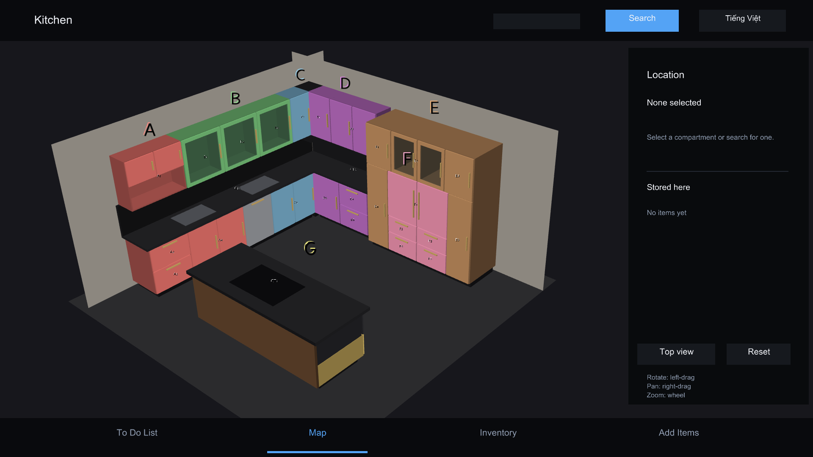
  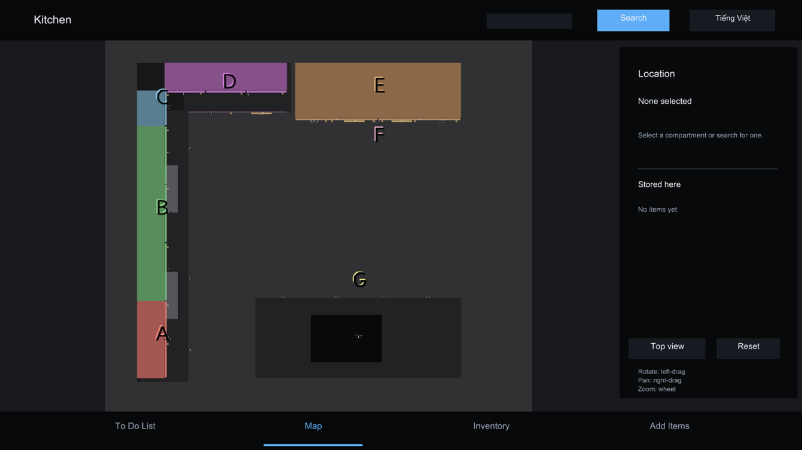
  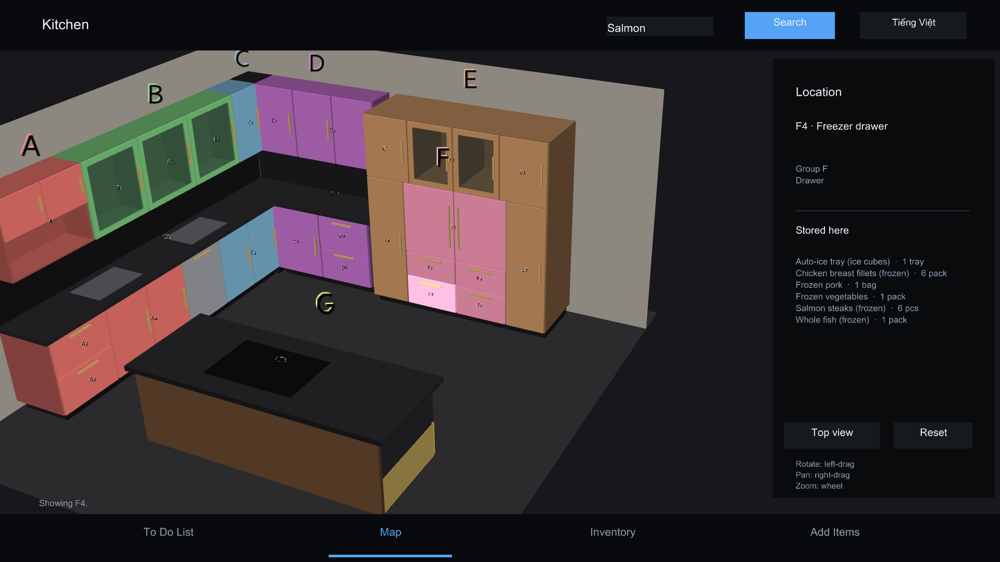
  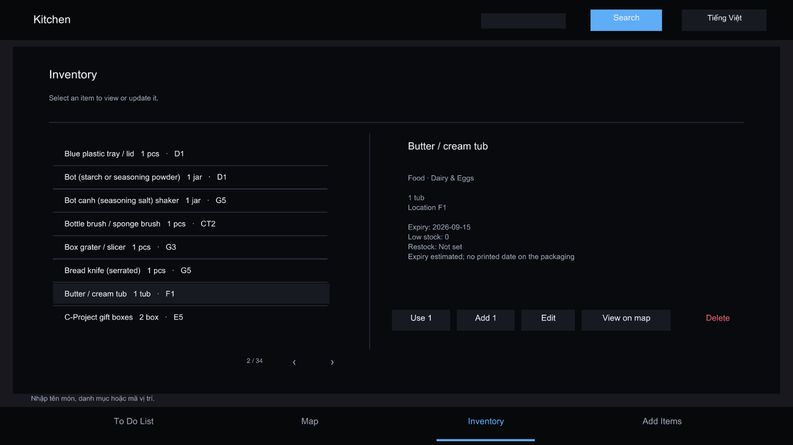
  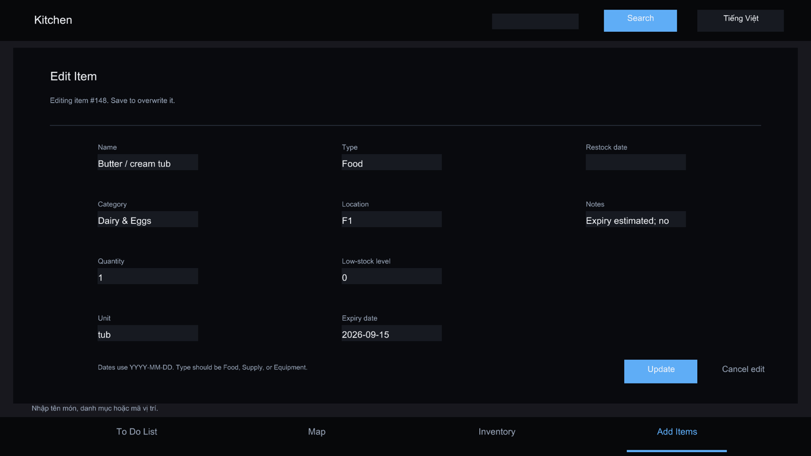
  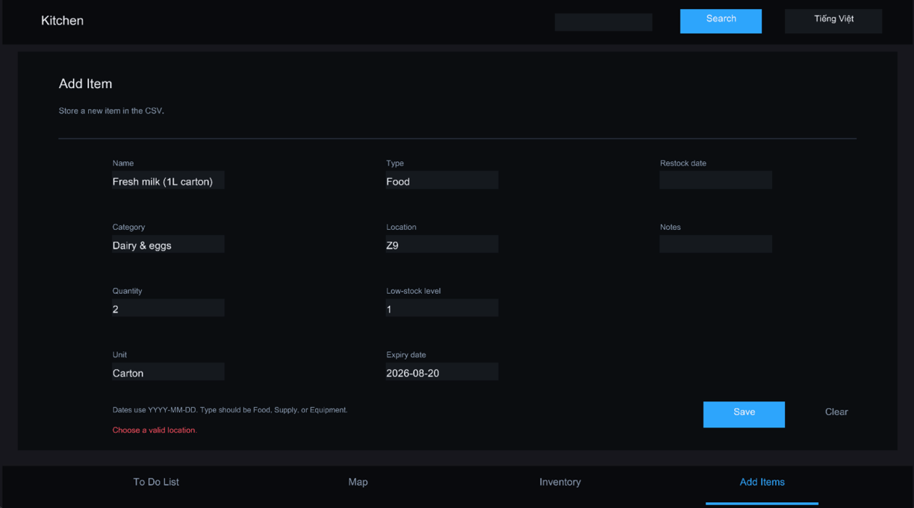
  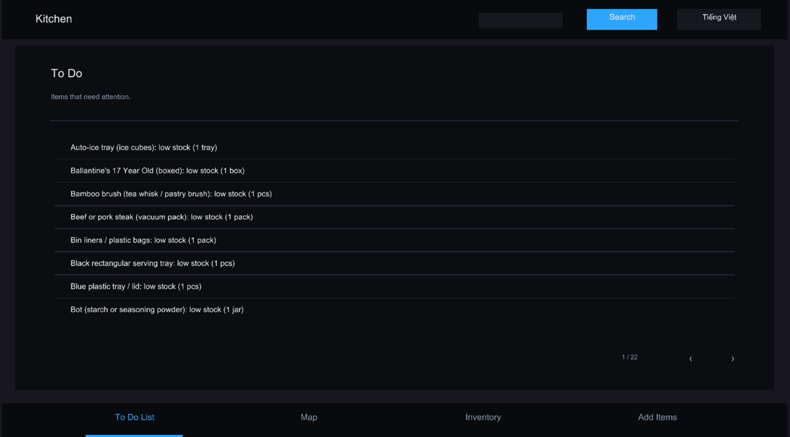
  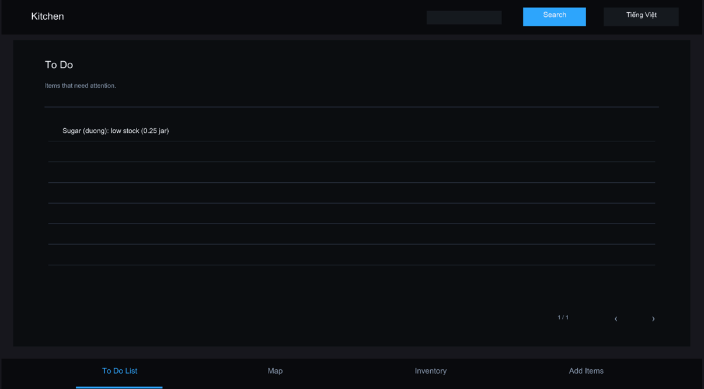
  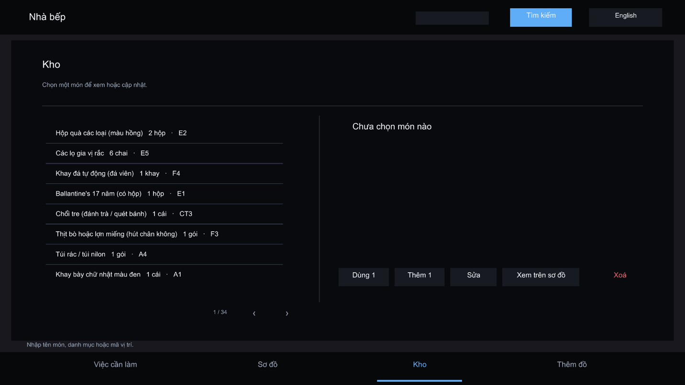
</p>

> **About the Claude co-author:** Claude was used only to write this README and its supporting files (such as screenshots, `.gitignore` and `requirements.txt`). The code itself is my own work.

---

<sub>Phạm Duy Long · Hà Nội · [phamduylong.com](https://phamduylong.com)</sub>
